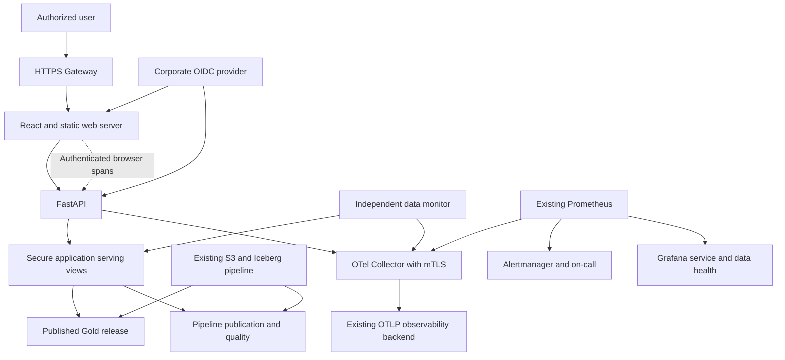

# Application architecture

## Boundaries

The browser has no Snowflake credentials and cannot supply a tenant, role, table or arbitrary SQL. FastAPI verifies an RS256 access token against a configured HTTPS issuer/JWKS endpoint and audience. It requires `sub`, `iat`, `exp`, `iss`, `aud`, the API scope, an allowlisted `tenant_id` and recognized `groups`. The application's verified tenant and group mapping select an explicit database role.

Each bounded query receives a fresh Snowflake session for that role and closes it afterward. No mutable database session is shared between tenants. This trades some connection latency for a small, auditable implementation. Four concurrent sessions per API pod are allowed by default; queue admission waits at most two seconds. Query, connection and warehouse-queue budgets are bounded. Capacity must be checked against actual load and warehouse cost before scaling.

The read-only service principal holds only approved tenant roles, warehouse/database/schema usage, and selected serving views. It must not inherit ACCOUNTADMIN, SYSADMIN, pipeline runner, table-owner or broad data-reader roles. Secondary roles are disabled on each session. Schema/bootstrap administration is a separate, one-time operator task.

## Publication consistency

Existing pipeline `SERVING` views omit the release ID. The bootstrap script creates `APP_CUSTOMERS`, `APP_POLICIES`, `APP_CLAIMS` and `APP_RELEASE` wrappers with explicit publication metadata. The existing pipeline publication state and the requested rows are read in one Snowflake statement. Signed cursors contain the tenant/filter fingerprint, release ID, bounded offset and 15-minute expiry. A changed publication returns HTTP 409 and the UI restarts browsing; it never silently appends a different release.

This app inherits the upstream design assumption of one pipeline/publication state per tenant. Do not attach multiple independent pipeline states to the same tenant in the supplied pipeline serving model. Review key uniqueness and pipeline ownership before onboarding another source. Offset browsing is bounded at 10,000 records; use narrower filters or a separately governed export workflow for larger datasets.

## Deployment

One application repository contains frontend, API, contracts, tests and its deployment assets. The lakehouse repository remains separate. The existing platform owns the cluster, HTTPS Gateway, identity provider, certificates, secrets manager, registry, monitoring backend and incident destination.

Two API and two web replicas are deployed by default, with HPA, resource limits, probes, non-root users, read-only filesystems, service accounts without Kubernetes API tokens, network policies and disruption budgets. Images target Linux amd64. Gateway TLS and private/corporate source restrictions are platform prerequisites. The chart uses Gateway API instead of retired community ingress-nginx.

The collector uses one StatefulSet replica and a persistent disk queue. This is an explicit compact-deployment choice: collector maintenance can create a telemetry gap, while application requests continue. It is not an HA or zero-loss telemetry guarantee. External Prometheus monitors collector availability; use your organization's established HA collector gateway if that is a mandatory SLO, and update metric routing/deduplication deliberately rather than merely scaling this Prometheus-exporting collector.
